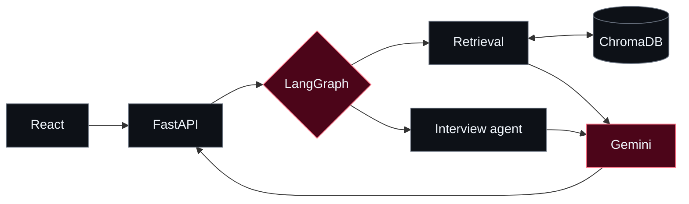

  <!-- CODE IN THE SHADOWS / OBSIDIAN + RUBY -->
  

  

  
<b>B.Tech CSE · IIIT Delhi</b> &nbsp;|&nbsp; Full-Stack &amp; AI Systems Builder

  

    
    
    
    
  

---

### `01 // ABOUT`

<table>
  <tr>
    <td width="66%" valign="top">
      <h3>I build software where design meets engineering.</h3>
      
I'm interested in <b>full-stack products, agentic AI, and immersive 3D experiences</b>. I enjoy turning complex ideas into practical systems with clear interfaces and maintainable architecture.

    </td>
    <td width="34%" valign="top">
      <h4><code>FOCUS / NOW</code></h4>
      
<code>01</code> &nbsp; Agentic AI &amp; RAG 
      <code>02</code> &nbsp; Full-stack systems 
      <code>03</code> &nbsp; Spatial computing

    </td>
  </tr>
</table>

### `02 // SELECTED WORK`

<!-- ONE STRONG FEATURED CARD, RATHER THAN A LONG PROJECT DESCRIPTION -->
<table>
  <tr>
    <td width="61%" valign="top">
      <b>01 / FEATURED BUILD &nbsp;·&nbsp; IN DEVELOPMENT</b>
      <h3>AI Placement Copilot</h3>
      
An AI-assisted placement preparation platform combining <b>multi-agent workflows</b>, semantic retrieval, and an accessible web interface.

      
<code>LangGraph</code> &nbsp; <code>FastAPI</code> &nbsp; <code>ChromaDB</code> &nbsp; <code>React</code>

      
<a href="https://github.com/harsh24239/ai-placement-copilot"><b>Explore the repository ↗</b></a>

    </td>
    <td width="39%" valign="top">
      <h4><code>HOW IT WORKS</code></h4>
      <pre>  STUDENT INPUT
       ↓
  FASTAPI + AGENTS
       ↓
  RETRIEVAL / RAG
       ↓
  GROUNDED RESPONSE</pre>
      Agent routing &amp; retrieval-based responses
    </td>
  </tr>
</table>

<!-- FOUR COMPACT PROJECT CARDS -->
<table>
  <tr>
    <td width="50%" valign="top">
      <code>02 / XR · SIMULATION</code>
      <h4>VR Manual Milling</h4>
      
Virtual machining trainer exploring force-based haptic feedback and 3D interaction.

      
<code>Unity</code> · <code>C#</code> · <code>Blender</code>

      <a href="https://github.com/harsh24239/vr-manual-milling-simulator"><b>View source ↗</b></a>
    </td>
    <td width="50%" valign="top">
      <code>03 / XR · EDUCATION</code>
      <h4>SpatialMath XR</h4>
      
Immersive 3D visualizations designed to make undergraduate mathematics easier to explore.

      
<code>Unity 3D</code> · <code>C#</code> · <code>Visualization</code>

      Research / interactive learning
    </td>
  </tr>
  <tr>
    <td width="50%" valign="top">
      <code>04 / WEB · SECURITY</code>
      <h4>SQVS — Credential Verifier</h4>
      
Qualification verification with role-based permissions, structured records, and audit logs.

      
<code>React</code> · <code>Node.js</code> · <code>MySQL</code>

      <a href="https://codeinshadows.vercel.app/#projects"><b>View case study ↗</b></a>
    </td>
    <td width="50%" valign="top">
      <code>05 / JAVA · ARCHITECTURE</code>
      <h4>University ERP</h4>
      
Modular academic system built with clearly separated UI, service, data access, and database layers.

      
<code>Java Swing</code> · <code>JDBC</code> · <code>JUnit 5</code>

      <a href="https://codeinshadows.vercel.app/#projects"><b>View case study ↗</b></a>
    </td>
  </tr>
</table>

<b>▸ View AI Placement Copilot architecture</b>

Conceptual flow · project in development

---

### `03 // TOOLKIT`

  
  
<b>Languages</b> &nbsp;·&nbsp; Python, Java, TypeScript, C/C++ &nbsp;&nbsp;|&nbsp;&nbsp; <b>Systems</b> &nbsp;·&nbsp; React, FastAPI, Node.js, MySQL &nbsp;&nbsp;|&nbsp;&nbsp; <b>AI &amp; XR</b> &nbsp;·&nbsp; LangGraph, ChromaDB, Unity

---

### `04 // GITHUB ACTIVITY`

  
  

  
<code>PRECISION OVER VOLUME</code> &nbsp;·&nbsp; <code>CODE IN THE SHADOWS</code> &nbsp;·&nbsp; <code>HARSH.DEV 影</code>

  

