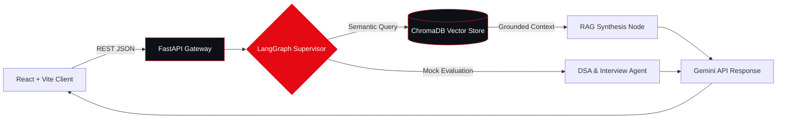
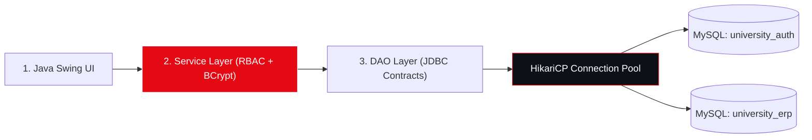

<div align="center">

  <!-- Animated Crimson Wave Header -->
  

  <!-- Dynamic Crimson Typing Sub-Header -->
  <a href="https://codeinshadows.vercel.app">
    
  </a>

  <p><i>"Mastery is not speed. It is the elimination of wasted motion."</i></p>

  <!-- Primary Command & Contact Channels -->
  <p>
    <a href="https://codeinshadows.vercel.app">
      
    </a>
    <a href="https://linkedin.com/in/harsh-kumar-837a9139b">
      
    </a>
    <a href="https://leetcode.com/u/codezharsh">
      
    </a>
    <a href="mailto:kumarharsh1851@gmail.com">
      
    </a>
  </p>

  <!-- Live Telemetry Badges -->
  <p>
    
    
    
  </p>

</div>

---

### `01 // OPERATIONAL TELEMETRY`

```diff
+ [SYSTEM ONLINE] :: HARSH KUMAR (影) — B.TECH CSE @ IIIT DELHI
! CLEARANCE       :: Available for Full-Stack, Agentic AI & SWE Roles
```

```yaml
operative: Harsh Kumar (影)
institution: IIIT Delhi (B.Tech CSE — 3rd Year)

telemetry:
  shipped_systems: "6+ Production & Research Builds"
  experience:      "3+ Years Active Development"
  dsa_foundation:  "130+ Problems Solved on LeetCode"

core_domains:
  01_web_systems:  "React.js, TypeScript, Node.js, Express, FastAPI"
  02_agentic_ai:   "LangGraph, Multi-Agent RAG, ChromaDB, Gemini API"
  03_spatial_xr:   "Unity 3D, C#, Blender, Haptic Force Feedback"
  04_architecture: "4-Layer Systems, RBAC, BCrypt, JWT, JUnit 5"
```

---

### `02 // THE TECH ARSENAL`

<div align="center">
  
</div>

<br/>

<div align="center">

| Layer | Production Stack & Tooling |
| :--- | :--- |
| **Languages & Core** |        |
| **Frontend & XR** |      |
| **Backend & APIs** |      |
| **Agentic AI & Data** |      |
| **Security & Craft** |      |

</div>

---

### `03 // THE DOSSIER — ENGINEERED SYSTEMS`

<table>
  <tr>
    <td width="50%" valign="top">
      <h3>🔴 01. AI Placement Copilot</h3>
      <p>
        
        
      </p>
      <p>Grounded placement preparation engine utilizing multi-agent LangGraph orchestration, ChromaDB vector retrieval, and a high-speed FastAPI + React interface.</p>
      <p><a href="https://github.com/harsh24239/ai-placement-copilot"><b>[ VIEW REPOSITORY ↗ ]</b></a></p>
    </td>
    <td width="50%" valign="top">
      <h3>🔴 02. SQVS — Qualification Verifier</h3>
      <p>
        
        
      </p>
      <p>Student Qualification Verification System engineered around strict Role-Based Access Control (RBAC), normalized relational schemas, and immutable audit trails.</p>
      <p><a href="https://codeinshadows.vercel.app/#projects"><b>[ CASE STUDY ↗ ]</b></a> · <a href="https://github.com/harsh24239"><b>[ GITHUB ↗ ]</b></a></p>
    </td>
  </tr>
  <tr>
    <td width="50%" valign="top">
      <h3>🔴 03. 4-Layer University ERP</h3>
      <p>
        
        
      </p>
      <p>Enterprise desktop ERP separating authentication (<code>university_auth</code>) and academic workflows across a strict 4-Layer Architecture with BCrypt & JUnit testing.</p>
      <p><a href="https://codeinshadows.vercel.app/#projects"><b>[ ARCHITECTURE ↗ ]</b></a> · <a href="https://github.com/harsh24239"><b>[ GITHUB ↗ ]</b></a></p>
    </td>
    <td width="50%" valign="top">
      <h3>🔴 04. SpatialMath XR & BitePass</h3>
      <p>
        
        
      </p>
      <p><b>SpatialMath:</b> Interactive VR visualization platform for 3D undergraduate mathematics.<br/><b>BitePass:</b> Campus canteen ordering & real-time queue architecture for IIIT Delhi.</p>
      <p><a href="https://codeinshadows.vercel.app"><b>[ EXPLORE PORTFOLIO ↗ ]</b></a></p>
    </td>
  </tr>
</table>

<details>
<summary><b>⚡ <code>[ CLICK TO RENDER LIVE MERMAID SYSTEM ARCHITECTURE DIAGRAMS ]</code></b></summary>
<br/>

#### `A. AI Placement Copilot — Multi-Agent LangGraph Pipeline`


#### `B. University ERP — 4-Layer Enterprise Security Flow`

</details>

---

### `04 // HOW THE SHADOW OPERATES`

<table>
  <tr>
    <td width="25%" valign="top">
      <h4><code>I // PRECISION</code></h4>
      <p><sub>One deliberate action outperforms a hundred frantic ones. Quality of execution is the only metric that matters.</sub></p>
    </td>
    <td width="25%" valign="top">
      <h4><code>II // ZERO TRACE</code></h4>
      <p><sub>Clean code. Clean contracts. Clean results. The footprint of an engineer is maintainable software.</sub></p>
    </td>
    <td width="25%" valign="top">
      <h4><code>III // EFFICIENCY</code></h4>
      <p><sub>Optimal algorithms, normalized schemas, and zero unnecessary overhead. Performance is a core feature.</sub></p>
    </td>
    <td width="25%" valign="top">
      <h4><code>IV // ADAPTABILITY</code></h4>
      <p><sub>No rigid stack dogma. From LangGraph agents to Unity XR and Java DAOs—the problem dictates the tool.</sub></p>
    </td>
  </tr>
</table>

---

### `05 // TELEMETRY, LEETCODE & COMMIT VELOCITY`

<div align="center">
  <table>
    <tr>
      <td width="50%" align="center">
        
      </td>
      <td width="50%" align="center">
        
      </td>
    </tr>
    <tr>
      <td colspan="2" align="center">
        
      </td>
    </tr>
  </table>
</div>

<!-- Animated Footer Wave -->

