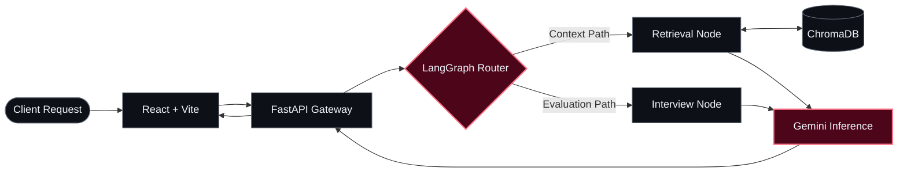
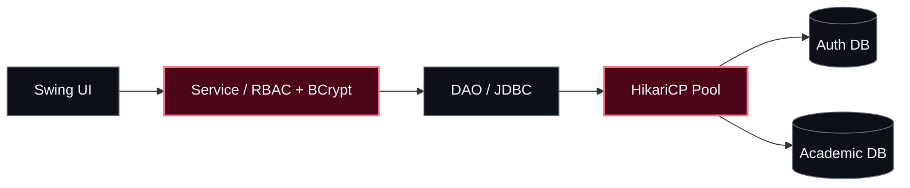

  <!-- HERO / CODE IN THE SHADOWS -->
  

  

  

    <b>B.Tech CSE @ IIIT Delhi</b> &nbsp;·&nbsp; Systems &amp; AI Engineer 
    <i>"Mastery is not speed. It is the elimination of wasted motion."</i>
  

  

    
    
    
    
  

  
  
  

---

### `01 // SYSTEM IDENTITY`

<table>
  <tr>
    <td width="48%" valign="top">
      <h4>▸ <code>IDENTITY.yaml</code></h4>
<pre lang="yaml">engineer:  Harsh Kumar (影)
base:      IIIT Delhi (B.Tech CSE)
domains:   [Full-Stack, Agentic AI, Spatial XR]
pipeline:  Architect → Build → Benchmark → Ship
state:     Active Development</pre>
    </td>
    <td width="52%" valign="top">
      <h4>▸ <code>ENGINEERING DOCTRINE</code></h4>
<pre lang="yaml">orchestration: Stateful Multi-Agent Workflows & RAG
architecture:  Strict Layer Isolation & Clean Contracts
performance:   Connection Pooling, Async I/O, Low Latency
spatial_xr:    Physics-Driven Haptics & 3D Computation
principle:     Zero unnecessary abstraction.</pre>
    </td>
  </tr>
</table>

  <code>01 / DETERMINISTIC DESIGN</code> &nbsp; · &nbsp; <code>02 / MODULAR BOUNDARIES</code> &nbsp; · &nbsp; <code>03 / PRODUCTION RELIABILITY</code>

---

### `02 // MISSION CONTROL — FLAGSHIP ARCHITECTURE`

  
  
  

  <h2>AI Placement Copilot</h2>
  
<b>Stateful multi-agent orchestration engine for technical interview simulation and grounded retrieval.</b>

<table>
  <tr>
    <td width="58%" valign="top">
      <h4>▸ <code>SYSTEM OVERVIEW</code></h4>
      
Unifies fragmented interview preparation into a single deterministic pipeline—combining <b>LangGraph agent routing</b>, <b>ChromaDB vector retrieval</b>, and an async <b>FastAPI + React</b> execution layer.

      <ul>
        <li><b>Supervisor Routing:</b> Dynamically dispatches queries between retrieval and mock-evaluation nodes.</li>
        <li><b>Grounded Memory:</b> Eliminates hallucinations via strict vector-context injection.</li>
      </ul>
      

        
      

    </td>
    <td width="42%" valign="top">
      <h4>▸ <code>SPEC // 001</code></h4>
<pre lang="yaml">TYPE:     Agentic AI / Full-Stack
CLIENT:   React + Vite
GATEWAY:  FastAPI (Async REST)
AGENTS:   LangGraph State Graph
MEMORY:   ChromaDB Vector Store
INFERENCE:Gemini API</pre>
    </td>
  </tr>
</table>

  

    
    &nbsp;→&nbsp;
    
    &nbsp;→&nbsp;
    
    &nbsp;→&nbsp;
    
  

<b>↳ SYSTEM BLUEPRINT — AGENT ROUTING &amp; RETRIEVAL TOPOLOGY</b>

 

---

### `03 // PROJECT ATLAS — DEPLOYED SYSTEMS`

#### `TRACK A // SPATIAL COMPUTING & HAPTIC SIMULATION`

<table>
  <tr>
    <td width="50%" valign="top">
      
      <h3>VR Manual Milling Simulator</h3>
      
Physics-driven virtual machining trainer translating simulated cutting resistance into real-time controller haptic feedback.

      
<b>PIPELINE</b> 
      <code>Tool Kinematics → Force Calculation → Haptic Pulse</code>

      
<code>Unity 3D</code> · <code>C#</code> · <code>XR Interaction Toolkit</code> · <code>Blender</code>

      
    </td>
    <td width="50%" valign="top">
      
      <h3>SpatialMath XR</h3>
      
Interactive 3D computation environment mapping abstract multivariable calculus and linear algebra into manipulable spatial scenes.

      
<b>PIPELINE</b> 
      <code>Symbolic Function → Procedural Mesh → 3D Manipulation</code>

      
<code>Unity 3D</code> · <code>C#</code> · <code>Computational Geometry</code> · <code>Shaders</code>

      

        
<b>↳ TECHNICAL SPECIFICATION</b>

        
Renders parametric surfaces and vector fields dynamically in 3D space for real-time spatial inspection.

      

    </td>
  </tr>
</table>

#### `TRACK B // SECURE PRODUCTS & LAYERED ARCHITECTURE`

<table>
  <tr>
    <td width="50%" valign="top">
      
      <h3>SQVS — Credential Verifier</h3>
      
Role-gated qualification verification platform engineered for relational integrity, permission isolation, and immutable audit trails.

      
<b>PIPELINE</b> 
      <code>Identity Auth → RBAC Guard → Relational Verify → Audit Log</code>

      
<code>React</code> · <code>Node.js</code> · <code>Express</code> · <code>MySQL</code> · <code>JWT</code>

      

        
<b>↳ ARCHITECTURAL FOCUS</b>

        
Strict separation of privilege tiers with deterministic state logging across every verification event.

      

    </td>
    <td width="50%" valign="top">
      
      <h3>4-Layer University ERP</h3>
      
Decoupled desktop ERP enforcing strict boundary isolation across presentation, service auth, DAO persistence, and pooled storage.

      
<b>PIPELINE</b> 
      <code>Swing UI → Service (RBAC/BCrypt) → DAO → HikariCP</code>

      
<code>Java</code> · <code>Swing</code> · <code>JDBC</code> · <code>HikariCP</code> · <code>JUnit 5</code>

      

        
<b>↳ ARCHITECTURAL FOCUS</b>

        
BCrypt hashing and role validation at the service boundary, backed by HikariCP connection pooling and JUnit 5 test suites.

      

    </td>
  </tr>
</table>

<b>↳ INSPECT 4-LAYER ERP TOPOLOGY</b>

 

---

### `04 // STACK & INFRASTRUCTURE`

  

 

| Layer | Core Primitives & Tooling |
| :--- | :--- |
| **Languages** | `Python` · `Java` · `TypeScript` · `JavaScript` · `C/C++` · `C#` · `SQL` |
| **Agentic AI & Data** | `LangGraph` · `Multi-Agent RAG` · `ChromaDB` · `Gemini API` · `MySQL` |
| **Backend & Web** | `FastAPI` · `Node.js` · `Express` · `React` · `Vite` · `REST Architecture` |
| **Systems & Security** | `RBAC` · `JWT` · `BCrypt` · `HikariCP` · `JDBC` · `JUnit 5` |
| **Spatial & Tooling** | `Unity 3D` · `XR Toolkit` · `Blender` · `Linux` · `Git` · `Figma` |

---

### `05 // TELEMETRY`

  
  

---

  

  
<code>PRECISION OVER VOLUME</code> &nbsp;•&nbsp; <code>LEAVE NO TRACE</code> &nbsp;•&nbsp; <code>HARSH.DEV 影</code>

  

