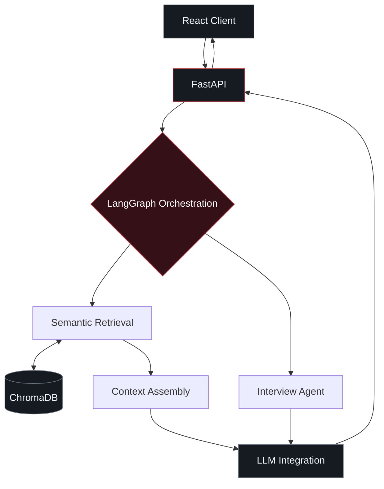
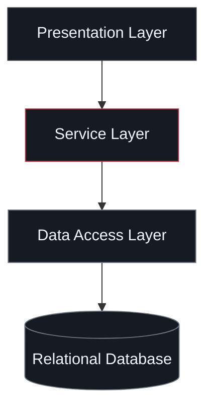

 

 

 

  

<code>BUILD WITH INTENT</code> &nbsp;·&nbsp; <code>DESIGN FOR SCALE</code> &nbsp;·&nbsp; <code>LEARN BY SHIPPING</code>

---

## `01 / PROFILE`

I'm a Computer Science undergraduate at **IIIT Delhi**, interested in building reliable software systems, AI-powered applications, and interactive spatial computing experiences.

My work spans full-stack development, retrieval-augmented generation, multi-agent workflows, database architecture, and Unity-based 3D simulation.

I enjoy working across the stack — understanding a problem, designing its architecture, implementing the solution, and refining it through testing and iteration.

- **Currently exploring:** Agentic AI, RAG pipelines, and AI-assisted developer tools.
- **Building with:** Python, TypeScript, Java, React, FastAPI, and Unity.
- **Interested in:** Software engineering, AI infrastructure, backend systems, and XR.
- **Portfolio:** [codeinshadows.vercel.app](https://codeinshadows.vercel.app)

---

## `02 / SELECTED PROJECTS`

<table>
<tr>
<td width="50%" valign="top">

### AI Placement Copilot

<code>AI ENGINEERING</code> · <code>IN PROGRESS</code>

An AI-powered placement preparation platform designed to combine contextual retrieval with specialized agent workflows.

- Multi-agent orchestration with LangGraph.
- Semantic retrieval using ChromaDB.
- API layer built with FastAPI.
- React-based user interface.

**Stack:** Python · LangGraph · ChromaDB · FastAPI · React

<a href="https://github.com/harsh24239/ai-placement-copilot">Explore repository ↗</a>

</td>
<td width="50%" valign="top">

### SpatialMath XR

<code>SPATIAL COMPUTING</code> · <code>RESEARCH</code>

An interactive VR learning environment that explores ways to make mathematical concepts more visual, spatial, and intuitive.

- Interactive 3D mathematical visualizations.
- Virtual textbook and learning panels.
- Unity-based XR interface.
- Exploration of symbolic mathematics integration.

**Stack:** Unity · C# · Blender · XR · SymPy

<a href="https://github.com/harsh24239/SpatialMath">Explore repository ↗</a>

</td>
</tr>
<tr>
<td width="50%" valign="top">

### VR Manual Milling Simulator

<code>XR SIMULATION</code> · <code>ENGINEERING</code>

A virtual milling training experience focused on interactive machine operation and exploring force-based haptic feedback.

- 3D machine and tool interaction.
- Virtual training workflows.
- Exploration of haptic interaction.

**Stack:** Unity · C# · Blender · XR

<a href="https://github.com/harsh24239/vr-manual-milling-simulator">Explore repository ↗</a>

</td>
<td width="50%" valign="top">

### Student Qualification Verification System

<code>FULL-STACK</code> · <code>WEB SYSTEMS</code>

A student credential verification application designed around structured data management and role-based access.

- React-based frontend.
- Node.js and Express backend.
- MySQL relational data model.
- Role-based access and audit logging.

**Stack:** React · Node.js · Express · MySQL

<a href="https://codeinshadows.vercel.app/#projects">View project case study ↗</a>

</td>
</tr>
</table>

### Additional engineering work

**Four-Layer University ERP**

A Java desktop application organized around separation of concerns, with distinct UI, service, data-access, and database layers.

`Java Swing` · `JDBC` · `HikariCP` · `MySQL` · `JUnit 5`

<a href="https://codeinshadows.vercel.app/#projects">View architecture and project details ↗</a>

---

## `03 / ENGINEERING APPROACH`

<b>AI Placement Copilot — Conceptual architecture</b>

 

Conceptual architecture; update the diagram to reflect the implementation as the system evolves.

<b>University ERP — Layered architecture</b>

 

---

## `04 / TECHNOLOGY STACK`

**Languages**

**Frontend and Backend**

**AI, Databases and Spatial Computing**

Technologies and tools used across projects and ongoing exploration.

---

## `05 / GITHUB ACTIVITY`

  

  

ENGINEER WITH CURIOSITY &nbsp;·&nbsp; BUILD WITH PURPOSE &nbsp;·&nbsp; IMPROVE CONTINUOUSLY

 

Harsh Kumar · IIIT Delhi

