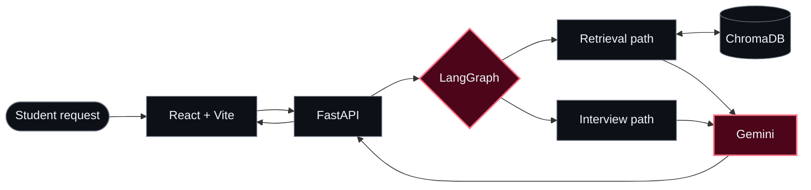
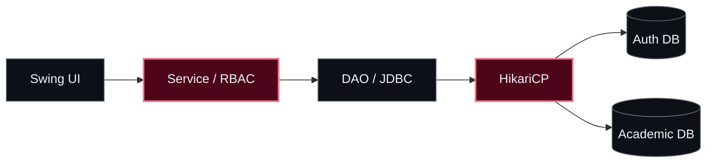

  <!-- HERO / CODE IN THE SHADOWS -->
  

  

  

    <b>B.Tech CSE @ IIIT Delhi</b> &nbsp;·&nbsp; Full-Stack &amp; AI Systems Builder 
    <i>"Mastery is not speed. It is the elimination of wasted motion."</i>
  

  

    
    
    
    
  

  
  
  

---

### `01 // THE DEVELOPER BEHIND THE SYSTEMS`

<table>
  <tr>
    <td width="48%" valign="top">
      <h4>▸ <code>IDENTITY.log</code></h4>
      <pre lang="yaml">name:     Harsh Kumar (影)
base:     IIIT Delhi
track:    B.Tech Computer Science
focus:    Full-Stack · Agentic AI · XR
approach: Design → Build → Test → Iterate
status:   Learning & shipping</pre>
    </td>
    <td width="52%" valign="top">
      <h4>▸ <code>WHAT I CARE ABOUT</code></h4>
      
I enjoy building software where <b>good architecture meets real usability</b> — from agentic AI workflows and full-stack products to spatial computing experiences.

      
My focus is on <b>clear interfaces, thoughtful system design, maintainable code, and solving the actual problem</b> rather than adding complexity for its own sake.

    </td>
  </tr>
</table>

  <code>01 / DESIGN WITH INTENT</code> &nbsp; · &nbsp; <code>02 / BUILD FOR REAL USERS</code> &nbsp; · &nbsp; <code>03 / REFINE RELENTLESSLY</code>

---

### `02 // MISSION CONTROL — FEATURED SYSTEM`

  
  
  

  <h2>AI Placement Copilot</h2>
  
<b>A multi-agent approach to preparing for technical interviews.</b> From a student's question to structured, context-grounded practice.

<table>
  <tr>
    <td width="58%" valign="top">
      <h4><code>THE IDEA</code></h4>
      
Placement preparation is scattered across practice questions, interview feedback, and study resources. <b>AI Placement Copilot</b> brings these workflows into one AI-assisted experience.

      
I'm building it around <b>LangGraph orchestration</b>, <b>ChromaDB retrieval</b>, and a <b>FastAPI + React</b> application layer, with Gemini for model-driven responses.

      

    </td>
    <td width="42%" valign="top">
      <h4><code>SYSTEM PROFILE / 001</code></h4>
      <pre>TYPE      AI / FULL-STACK
STATUS    IN DEVELOPMENT
CLIENT    REACT + VITE
GATEWAY   FASTAPI
AGENTS    LANGGRAPH
MEMORY    CHROMADB
MODEL     GEMINI</pre>
      
Focus: orchestration, grounded retrieval, clear interfaces, and a modular backend.

    </td>
  </tr>
</table>

  <b>THE WORKFLOW AT A GLANCE</b>
  

    
    &nbsp;→&nbsp;
    
    &nbsp;→&nbsp;
    
    &nbsp;→&nbsp;
    
  

<b>↳ EXPLORE THE ENGINEERING BLUEPRINT — AGENTS, RETRIEVAL & DELIVERY</b>

 

> Conceptual architecture of the project; individual features are under active development.

**Design lens:** Separate routing, retrieval, and response generation so each part can be understood, tested, and improved independently.

---

### `03 // PROJECT ATLAS — SELECT A DOMAIN`

  
  
Different mediums. Same mindset: understand the problem, design the system, build the experience.

#### `TRACK A // SPATIAL COMPUTING & HUMAN INTERACTION`

<table>
  <tr>
    <td width="50%" valign="top">
      
      <h3>VR Manual Milling</h3>
      
<b>Teaching physical processes in virtual space.</b>

      
A VR milling trainer prototype that connects simulated machining interactions to controller haptic feedback.

      
<b>INTERACTION LOOP</b> 
      <code>Handle → Cutting force → Haptics</code>

      
<code>Unity</code> · <code>C#</code> · <code>Blender</code> · <code>XR Toolkit</code>

      
    </td>
    <td width="50%" valign="top">
      
      <h3>SpatialMath XR</h3>
      
<b>Making abstract mathematics spatial.</b>

      
An immersive 3D approach to exploring undergraduate mathematical concepts through interaction and visualization.

      
<b>EXPERIENCE LOOP</b> 
      <code>Concept → 3D model → Explore</code>

      
<code>Unity 3D</code> · <code>C#</code> · <code>Visualization</code>

      

        
<b>↳ OPEN PROJECT BRIEF</b>

        
Focus: representing mathematical ideas as interactive 3D scenes, so spatial relationships can be explored rather than only imagined.

      

    </td>
  </tr>
</table>

#### `TRACK B // SECURE PRODUCTS & SYSTEM ARCHITECTURE`

<table>
  <tr>
    <td width="50%" valign="top">
      
      <h3>SQVS — Credential Verifier</h3>
      
<b>Trust depends on more than storing records.</b>

      
A student qualification verification system designed around user permissions, relational records, and traceable activity.

      
<b>VERIFICATION FLOW</b> 
      <code>Identity → RBAC → Verify → Audit</code>

      
<code>React</code> · <code>Node.js</code> · <code>Express</code> · <code>MySQL</code>

      

        
<b>↳ EXPLORE DESIGN DECISIONS</b>

        
<b>Key concerns:</b> separating user roles, keeping qualification data structured, and retaining an audit trail of actions.

      

    </td>
    <td width="50%" valign="top">
      
      <h3>4-Layer University ERP</h3>
      
<b>A desktop app with boundaries that matter.</b>

      
An academic ERP organized to keep the interface, business logic, database access, and persistence separate.

      
<b>ARCHITECTURE FLOW</b> 
      <code>UI → Service → DAO → Database</code>

      
<code>Java Swing</code> · <code>JDBC</code> · <code>HikariCP</code> · <code>JUnit 5</code>

      

        
<b>↳ VIEW 4-LAYER BLUEPRINT</b>

        
<b>Security &amp; structure:</b> RBAC and BCrypt at the service boundary; JDBC/DAO for data access; HikariCP for connection pooling; JUnit 5 for testing.

      

    </td>
  </tr>
</table>

<b>↳ BONUS BLUEPRINT — HOW THE UNIVERSITY ERP IS LAYERED</b>

 

---

### `04 // THE TOOLKIT`

  

 

| Layer | Tools & Technologies |
| :--- | :--- |
| **Languages** | `Python` · `Java` · `TypeScript` · `JavaScript` · `C/C++` · `C#` · `SQL` |
| **Web & APIs** | `React` · `Vite` · `FastAPI` · `Node.js` · `Express` · `REST APIs` |
| **AI & Data** | `LangGraph` · `RAG` · `ChromaDB` · `Gemini API` · `MySQL` |
| **Architecture & Testing** | `RBAC` · `JWT` · `BCrypt` · `HikariCP` · `JDBC` · `JUnit 5` |
| **XR & Creative Tools** | `Unity 3D` · `Blender` · `Figma` · `Git` · `Linux` |

---

### `05 // GITHUB TELEMETRY`

  
  
  
Code statistics reflect public repository activity, not a full measure of engineering experience.

---

  <h3>Have an interesting problem to solve?</h3>
  
I'm interested in thoughtful software, useful AI, and products that make complex ideas easier to use.

  

  
<code>PRECISION OVER VOLUME</code> &nbsp;•&nbsp; <code>LEAVE NO TRACE</code> &nbsp;•&nbsp; <code>HARSH.DEV 影</code>

  

