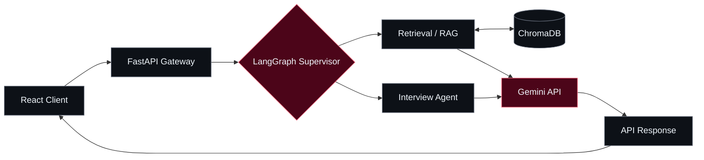
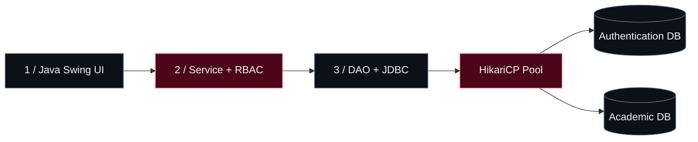

  <!-- HERO / CODE IN THE SHADOWS -->
  

  

  

    <b>B.Tech CSE @ IIIT Delhi</b> &nbsp;·&nbsp; Full-Stack &amp; AI Systems Builder 
    <i>"Mastery is not speed. It is the elimination of wasted motion."</i>
  

  

    
    
    
    
  

  
  
  

---

### `01 // THE DEVELOPER BEHIND THE SYSTEMS`

<table>
  <tr>
    <td width="48%" valign="top">
      <h4>▸ <code>IDENTITY.log</code></h4>
      <pre lang="yaml">name:     Harsh Kumar (影)
base:     IIIT Delhi
track:    B.Tech Computer Science
focus:    Full-Stack · Agentic AI · XR
approach: Design → Build → Test → Iterate
status:   Learning & shipping</pre>
    </td>
    <td width="52%" valign="top">
      <h4>▸ <code>WHAT I CARE ABOUT</code></h4>
      
I enjoy building software where <b>good architecture meets real usability</b> — from agentic AI workflows and full-stack products to spatial computing experiences.

      
My focus is on <b>clear interfaces, thoughtful system design, maintainable code, and solving the actual problem</b> rather than adding complexity for its own sake.

    </td>
  </tr>
</table>

  <code>01 / DESIGN WITH INTENT</code> &nbsp; · &nbsp; <code>02 / BUILD FOR REAL USERS</code> &nbsp; · &nbsp; <code>03 / REFINE RELENTLESSLY</code>

---

### `02 // FEATURED BUILD`

<table>
  <tr>
    <td valign="top">
      
      
      <h3>AI Placement Copilot ↗ Agentic AI / RAG</h3>
      
A placement-preparation platform built around <b>multi-agent orchestration, context-grounded retrieval, and a full-stack user experience</b>.

      
<b>Inside the system:</b> LangGraph coordinates agent workflows, ChromaDB supports semantic retrieval, and FastAPI connects the AI layer to a React interface.

      

        <code>Python</code> <code>FastAPI</code> <code>LangGraph</code> <code>ChromaDB</code> <code>React</code> <code>Gemini API</code>
      

      
    </td>
  </tr>
</table>

### `03 // MORE SYSTEMS IN THE LAB`

<table>
  <tr>
    <td width="50%" valign="top">
      
      <h4>VR Manual Milling Simulator</h4>
      
Research-aligned VR milling trainer exploring physical interaction and force-based haptic feedback in a simulated environment.

      
<code>Unity</code> <code>C#</code> <code>Blender</code> <code>Haptics</code>

      <a href="https://github.com/harsh24239/vr-manual-milling-simulator"><b>REPOSITORY ↗</b></a>
    </td>
    <td width="50%" valign="top">
      
      <h4>SpatialMath XR</h4>
      
An interactive 3D learning concept for exploring undergraduate mathematics through spatial visualization.

      
<code>Unity 3D</code> <code>C#</code> <code>3D Visualization</code>

      <a href="https://codeinshadows.vercel.app/#projects"><b>VIEW ON PORTFOLIO ↗</b></a>
    </td>
  </tr>
  <tr>
    <td width="50%" valign="top">
      
      <h4>SQVS — Credential Verifier</h4>
      
Student qualification verification platform organized around role-based access control, relational data modeling, and audit logging.

      
<code>React</code> <code>Node.js</code> <code>Express</code> <code>MySQL</code>

      <a href="https://codeinshadows.vercel.app/#projects"><b>PROJECT DETAILS ↗</b></a>
    </td>
    <td width="50%" valign="top">
      
      <h4>4-Layer University ERP</h4>
      
Desktop ERP separating user interface, business logic, data access, and storage, with distinct authentication and academic workflows.

      
<code>Java Swing</code> <code>JDBC</code> <code>HikariCP</code> <code>JUnit 5</code>

      <a href="https://codeinshadows.vercel.app/#projects"><b>ARCHITECTURE DETAILS ↗</b></a>
    </td>
  </tr>
</table>

<b>▸ OPEN THE BLUEPRINTS — TWO SYSTEM ARCHITECTURES</b>

 

**A / AI Placement Copilot · conceptual workflow**

**B / University ERP · layered architecture**

---

### `04 // THE TOOLKIT`

  

 

| Layer | Tools & Technologies |
| :--- | :--- |
| **Languages** | `Python` · `Java` · `TypeScript` · `JavaScript` · `C/C++` · `C#` · `SQL` |
| **Web & APIs** | `React` · `Vite` · `FastAPI` · `Node.js` · `Express` · `REST APIs` |
| **AI & Data** | `LangGraph` · `RAG` · `ChromaDB` · `Gemini API` · `MySQL` |
| **Architecture & Testing** | `RBAC` · `JWT` · `BCrypt` · `HikariCP` · `JDBC` · `JUnit 5` |
| **XR & Creative Tools** | `Unity 3D` · `Blender` · `Figma` · `Git` · `Linux` |

---

### `05 // GITHUB TELEMETRY`

  
  
  
Code statistics reflect public repository activity, not a full measure of engineering experience.

---

  <h3>Have an interesting problem to solve?</h3>
  
I'm interested in thoughtful software, useful AI, and products that make complex ideas easier to use.

  

  
<code>PRECISION OVER VOLUME</code> &nbsp;•&nbsp; <code>LEAVE NO TRACE</code> &nbsp;•&nbsp; <code>HARSH.DEV 影</code>

  

