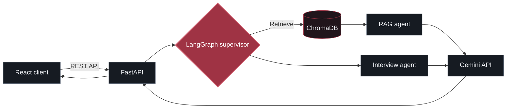

  

  

   

  
  
  
  

  
<code>ENGINEERING WITH INTENT</code> &nbsp;·&nbsp; <code>LEARNING IN PUBLIC</code> &nbsp;·&nbsp; <code>OPEN TO COLLABORATION</code>

---

### `01 / ABOUT & FOCUS`

<table>
  <tr>
    <td width="43%" valign="top">
      <h4>◈ <code>PROFILE.LOG</code></h4>
      
<b>Harsh Kumar</b> 
      CS &amp; Applied Mathematics · IIIT Delhi

      
I build software at the intersection of <b>AI, web systems, and immersive computing</b>—with an interest in clean architecture, practical tooling, and reliable products.

      
<code>Currently exploring</code> Agent workflows · Retrieval systems · Developer tools

    </td>
    <td width="57%" valign="top">
      <h4>◈ <code>ENGINEERING FOCUS</code></h4>
      
<b>01 · Agentic AI</b> LangGraph orchestration, RAG pipelines, vector search, FastAPI

      
<b>02 · Full-stack products</b> React, TypeScript, Node.js, Express, relational databases

      
<b>03 · System design</b> Layered architecture, authentication, RBAC, testing

      
<b>04 · Spatial computing</b> Unity, C#, Blender, interactive 3D and XR

    </td>
  </tr>
</table>

---

### `02 / SELECTED PROJECTS`

<table>
  <tr>
    <td width="50%" valign="top">
      <h3>01 · AI Placement Copilot</h3>
      
      
<code>FastAPI</code> · <code>LangGraph</code> · <code>ChromaDB</code> · <code>React</code>

      
An AI-assisted placement preparation platform combining coordinated agent workflows with retrieval-grounded responses and a FastAPI backend.

      <a href="https://github.com/harsh24239/ai-placement-copilot"><b>Explore repository ↗</b></a>
    </td>
    <td width="50%" valign="top">
      <h3>02 · VR Milling &amp; SpatialMath</h3>
      
      
<code>Unity</code> · <code>C#</code> · <code>Blender</code> · <code>XR</code>

      
Two immersive learning projects: a haptic manual-milling simulator and a 3D environment for exploring undergraduate mathematics.

      <a href="https://github.com/harsh24239/vr-manual-milling-simulator"><b>Milling simulator ↗</b></a> &nbsp;·&nbsp; <a href="https://github.com/harsh24239/SpatialMath"><b>SpatialMath ↗</b></a>
    </td>
  </tr>
  <tr>
    <td width="50%" valign="top">
      <h3>03 · SQVS Credential Verifier</h3>
      
      
<code>React</code> · <code>Node.js</code> · <code>Express</code> · <code>MySQL</code>

      
A student qualification verification system designed with role-based access control, structured relational data, and audit-friendly workflows.

      <a href="https://codeinshadows.vercel.app/#projects"><b>View case study ↗</b></a>
    </td>
    <td width="50%" valign="top">
      <h3>04 · University ERP</h3>
      
      
<code>Java Swing</code> · <code>JDBC</code> · <code>HikariCP</code> · <code>JUnit 5</code>

      
A modular university management application separating UI, services, data access, and persistence, with dedicated authentication and academic modules.

      <a href="https://codeinshadows.vercel.app/#projects"><b>View architecture ↗</b></a>
    </td>
  </tr>
</table>

<b>↳ Explore the AI Placement Copilot architecture</b>

 

Conceptual flow based on the listed architecture; see the repository for the current implementation.

---

### `03 / TECH STACK`

| Area | Tools & technologies |
| :-- | :-- |
| **Languages** |        |
| **Web & APIs** |      |
| **AI & data** |     |
| **Systems & XR** |       |

---

### `04 / GITHUB ACTIVITY`

  
  

---

  <code>BUILD WITH PURPOSE.</code> &nbsp; • &nbsp; <code>SHIP WHAT MATTERS.</code> &nbsp; • &nbsp; <code>HARSH KUMAR 影</code>

