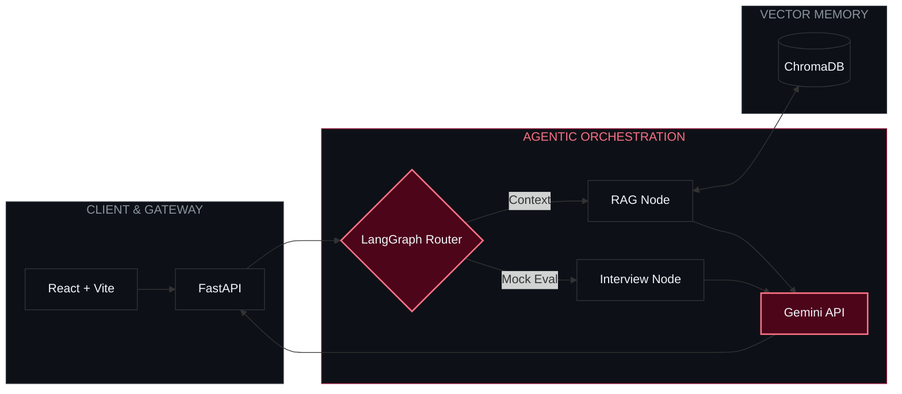
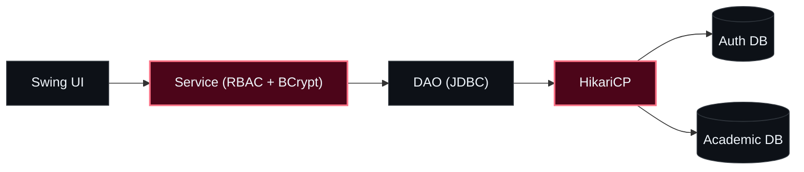

  

  

  

    
    
    
    
  

---

### `01 // SYSTEM PROFILE`

<table>
  <tr>
    <td width="50%" valign="top">
<pre lang="yaml">engineer:  Harsh Kumar (影)
institute: IIIT Delhi (B.Tech CSE)
location:  New Delhi, IN
status:    Open to SWE & AI Roles</pre>
    </td>
    <td width="50%" valign="top">
<pre lang="yaml">ai_systems:   LangGraph · Multi-Agent RAG · Vector DBs
backend:      FastAPI · Node.js · RBAC · HikariCP
spatial_xr:   Unity 3D · Haptic Physics · Shaders
philosophy:   Strict boundaries. Zero bloat.</pre>
    </td>
  </tr>
</table>

---

### `02 // SYSTEMS ARCHITECTURE`

<!-- TOP BENTO SPAN: FLAGSHIP -->
<table>
  <tr>
    <td width="60%" valign="top">
      
      
      <h3>AI Placement Copilot</h3>
<pre lang="yaml">scope: Stateful interview simulation & grounded retrieval
flow:  Query ➔ LangGraph Router ➔ [RAG | Eval] ➔ Gemini</pre>
      

        
        &nbsp;
        
      

    </td>
    <td width="40%" valign="top">
<pre lang="yaml">CLIENT:    React + Vite
GATEWAY:   FastAPI (Async REST)
AGENTS:    LangGraph State Graph
MEMORY:    ChromaDB Vector Store
INFERENCE: Gemini API
ROUTING:   Deterministic</pre>
    </td>
  </tr>
</table>

<!-- 2x2 BENTO GRID: CORE SYSTEMS -->
<table>
  <tr>
    <td width="50%" valign="top">
      
      <h3>VR Manual Milling</h3>
<pre lang="yaml">scope: Virtual machining & force feedback
flow:  Kinematics ➔ Force Calc ➔ Haptics</pre>
      

        
        &nbsp;
        
      

    </td>
    <td width="50%" valign="top">
      
      <h3>SpatialMath XR</h3>
<pre lang="yaml">scope: Interactive 3D multivariable math
flow:  Function ➔ Procedural Mesh ➔ 3D Scene</pre>
      

        
        &nbsp;
        
      

    </td>
  </tr>
  <tr>
    <td width="50%" valign="top">
      
      <h3>SQVS — Credential Verifier</h3>
<pre lang="yaml">scope: Role-gated qualification verification
flow:  JWT ➔ RBAC Guard ➔ Verify ➔ Audit Log</pre>
      

        
        &nbsp;
        
      

    </td>
    <td width="50%" valign="top">
      
      <h3>4-Layer University ERP</h3>
<pre lang="yaml">scope: Decoupled desktop academic ERP
flow:  Swing ➔ Service (RBAC) ➔ DAO ➔ HikariCP</pre>
      

        
        &nbsp;
        
      

    </td>
  </tr>
</table>

<b>↳ INSPECT 4-LAYER ERP TOPOLOGY</b>

 

---

### `03 // INFRASTRUCTURE & TOOLING`

  

 

| Domain | Core Primitives |
| :--- | :--- |
| **Languages** | `Python` · `Java` · `TypeScript` · `JavaScript` · `C/C++` · `C#` · `SQL` |
| **AI & Data** | `LangGraph` · `Multi-Agent RAG` · `ChromaDB` · `Gemini API` · `MySQL` |
| **Backend & Auth** | `FastAPI` · `Node.js` · `Express` · `RBAC` · `JWT` · `BCrypt` · `HikariCP` · `JUnit 5` |
| **Frontend & XR** | `React` · `Vite` · `Unity 3D` · `XR Toolkit` · `Blender` · `Linux` |

---

### `04 // TELEMETRY`

  
  
   
  

   
  
<code>PRECISION OVER VOLUME</code> &nbsp;•&nbsp; <code>HARSH.DEV 影</code>

  

