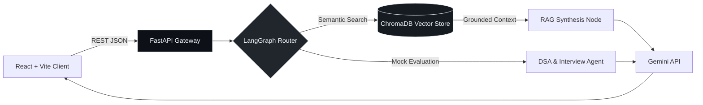

  <!-- Architectural Graphite Monochrome Studio Header -->
  

   

  <!-- Full-Size Editorial Thesis & Telemetry -->
  

    <b>B.Tech CSAM @ IIIT Delhi</b> &nbsp;·&nbsp; <b>New Delhi, India</b> &nbsp;·&nbsp; <code><b>Open to SWE & AI Roles</b></code> 
    <i>"Mastery is not speed. It is the elimination of wasted motion."</i>
  

  <!-- Unified 4-Channel Graphite Command Bar (Larger for-the-badge Sizing) -->
  

    &nbsp;
    &nbsp;
    &nbsp;
    
  

---

### `01 // ENGINEERING DISCIPLINES`

<table>
  <tr>
    <td width="33%" valign="top">
      <code><b>I // ARCHITECTURE</b></code>
      <h3>Full-Stack Systems</h3>
      
Modular backends, role-gated security (RBAC), connection pooling, and clean API contracts engineered for production reliability.

    </td>
    <td width="33%" valign="top">
      <code><b>II // INTELLIGENCE</b></code>
      <h3>Agentic AI & RAG</h3>
      
Stateful multi-agent orchestration, ChromaDB vector retrieval, and context-grounded LLM workflows with low-latency gateways.

    </td>
    <td width="33%" valign="top">
      <code><b>III // INTERACTION</b></code>
      <h3>Spatial XR & Craft</h3>
      
Immersive 3D mathematical environments, real-time spatial visualization, and high-precision interfaces with zero clutter.

    </td>
  </tr>
</table>

---

### `02 // SELECTED WORKS`

<table>
  <tr>
    <td width="50%" valign="top">
      
<code><b>01 // AGENTIC AI & RAG</b></code> &nbsp;·&nbsp; <code>ACTIVE BUILD</code>

      <h3>AI Placement Copilot</h3>
      
Stateful multi-agent interview and placement preparation platform unifying practice workflows, grounded vector retrieval, and real-time evaluation.

      
<code>React + Vite</code> · <code>FastAPI</code> · <code>LangGraph</code> · <code>ChromaDB</code> · <code>Gemini API</code>

      
<a href="https://github.com/harsh24239/ai-placement-copilot"><kbd> VIEW REPOSITORY ↗ </kbd></a>

    </td>
    <td width="50%" valign="top">
      
<code><b>02 // SPATIAL COMPUTING</b></code>

      <h3>SpatialMath XR</h3>
      
Interactive 3D computation environment translating abstract multivariable mathematics into manipulable spatial scenes.

      
<code>Unity 3D</code> · <code>C#</code> · <code>3D Visualization</code> · <code>Custom Shaders</code>

      
<a href="https://github.com/harsh24239/SpatialMath"><kbd> VIEW REPOSITORY ↗ </kbd></a>

    </td>
  </tr>
  <tr>
    <td width="50%" valign="top">
      
<code><b>03 // ACCESS CONTROL & SECURITY</b></code>

      <h3>SQVS — Qualification Verifier</h3>
      
Role-gated credential verification system built around strict RBAC permissions, normalized schemas, and immutable audit logs.

      
<code>React</code> · <code>Node.js</code> · <code>Express</code> · <code>MySQL</code> · <code>RBAC</code>

      
<a href="https://github.com/Anilcodee/sqvs"><kbd> VIEW ON GITHUB ↗ </kbd></a>

    </td>
    <td width="50%" valign="top">
      
<code><b>04 // ENTERPRISE DESKTOP CORE</b></code>

      <h3>4-Layer University ERP</h3>
      
Decoupled desktop ERP isolating Swing presentation, BCrypt/RBAC service logic, JDBC DAO persistence, and HikariCP pooling.

      
<code>Java Swing</code> · <code>JDBC</code> · <code>HikariCP</code> · <code>BCrypt</code> · <code>JUnit 5</code>

      
<a href="https://github.com/Anilcodee/erp_university"><kbd> VIEW ON GITHUB ↗ </kbd></a>

    </td>
  </tr>
</table>

<b><code>+ EXPAND SYSTEM ARCHITECTURE BLUEPRINTS (MERMAID.JS)</code></b>

 

---

### `03 // TECHNICAL SPECIFICATION`

| Layer | Production Technologies & Methods | Stack |
| :--- | :--- | :---: |
| **Languages** | `Python` · `Java` · `TypeScript` · `JavaScript` · `C / C++` · `C#` · `SQL` |  |
| **Web & Backend** | `React` · `Vite` · `FastAPI` · `Node.js` · `Express` · `REST APIs` · `HikariCP` |  |
| **AI & Data** | `LangGraph` · `Multi-Agent RAG` · `ChromaDB` · `Gemini API` · `MySQL` · `SQLite` |  |
| **Spatial & Craft** | `Unity 3D` · `XR Toolkit` · `Blender` · `Figma` · `JUnit 5` · `RBAC / JWT` · `Git` |  |

---

### `04 // TELEMETRY`

  <table>
    <tr>
      <td width="50%" align="center">
        
      </td>
      <td width="50%" align="center">
        
      </td>
    </tr>
  </table>
  
<b><code>DESIGN WITH INTENT</code></b> &nbsp;•&nbsp; <b><code>PRECISION OVER VOLUME</code></b> &nbsp;•&nbsp; <b><code>HARSH.DEV</code></b>

