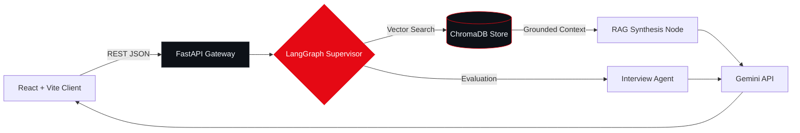

  <!-- Soft-Edge Animated Crimson Studio Header -->
  

  <!-- Precision Terminal Typing Animation -->
  

  <!-- Single-Line Command Bar (Compact Labels = Zero Wrapping, Zero Blue Ticks) -->
  

    
    
    
    
  

---

### `01 // ARCHITECTURE & FOCUS`

<table>
  <tr>
    <td width="50%" valign="top">
      <h4><code>SYSTEM TELEMETRY</code></h4>
      <pre lang="yaml">
operative: Harsh Kumar (影)
institute: IIIT Delhi (B.Tech CSE)
focus:     Web, Agentic AI & XR
tenure:    3+ Years Building
shipped:   6+ Core Systems
clearance: Open to SWE & AI Roles</pre>
    </td>
    <td width="50%" valign="top">
      <h4><code>ENGINEERING DOMAINS</code></h4>
      <ul>
        <li><b>Agentic AI & RAG:</b> Multi-agent flows with <code>LangGraph</code>, <code>ChromaDB</code> & <code>FastAPI</code>.</li>
        <li><b>Full-Stack Web:</b> Production apps via <code>React</code>, <code>TypeScript</code>, <code>Node.js</code> & <code>Express</code>.</li>
        <li><b>Enterprise Systems:</b> 4-Layer design, <code>RBAC</code>, <code>HikariCP</code>, <code>BCrypt</code> & <code>JUnit 5</code>.</li>
        <li><b>Spatial XR:</b> Haptic 3D simulation in <code>Unity</code>, <code>C#</code> & <code>Blender</code>.</li>
      </ul>
    </td>
  </tr>
</table>

---

### `02 // SELECTED ENGINEERING WORK`

<table>
  <tr>
    <td width="50%" valign="top">
      <h4>🔴 AI Placement Copilot &nbsp;<code>ACTIVE</code></h4>
      
<code>FastAPI</code> · <code>LangGraph</code> · <code>ChromaDB</code> · <code>React</code>

      
Grounded placement preparation engine utilizing multi-agent LangGraph orchestration, semantic vector retrieval, and a low-latency FastAPI gateway.

      
<a href="https://github.com/harsh24239/ai-placement-copilot"><kbd> VIEW REPOSITORY ↗ </kbd></a>

    </td>
    <td width="50%" valign="top">
      <h4>⚪ VR Milling & SpatialMath XR &nbsp;<code>RESEARCH</code></h4>
      
<code>Unity 3D</code> · <code>C#</code> · <code>Blender</code> · <code>XR Haptics</code>

      
Force-based haptic manual milling trainer and an interactive 3D Virtual Reality platform designed to visualize undergraduate mathematics.

      

        <a href="https://github.com/harsh24239/vr-manual-milling-simulator"><kbd> MILLING XR ↗ </kbd></a>
        <a href="https://github.com/harsh24239/SpatialMath"><kbd> SPATIALMATH ↗ </kbd></a>
      

    </td>
  </tr>
  <tr>
    <td width="50%" valign="top">
      <h4>⚪ SQVS — Credential Verifier &nbsp;<code>SHIPPED</code></h4>
      
<code>React.js</code> · <code>Node.js</code> · <code>Express</code> · <code>MySQL</code>

      
Student Qualification Verification System engineered around strict Role-Based Access Control (RBAC), normalized relational schemas, and audit logs.

      
<a href="https://codeinshadows.vercel.app/#projects"><kbd> CASE STUDY ↗ </kbd></a>

    </td>
    <td width="50%" valign="top">
      <h4>⚪ 4-Layer University ERP &nbsp;<code>SHIPPED</code></h4>
      
<code>Java Swing</code> · <code>JDBC</code> · <code>HikariCP</code> · <code>JUnit 5</code>

      
Modular desktop ERP isolating authentication (<code>university_auth</code>) and academic operations across a strict <code>UI → Service → DAO → DB</code> architecture.

      
<a href="https://codeinshadows.vercel.app/#projects"><kbd> ARCHITECTURE ↗ </kbd></a>

    </td>
  </tr>
</table>

<b><code>+ INSPECT SYSTEM ARCHITECTURE BLUEPRINTS (MERMAID.JS)</code></b>

 

---

### `03 // PRODUCTION STACK & TOOLING`

| Domain | Technologies |
| :--- | :--- |
| **Languages** |        |
| **Web & Backend** |       |
| **AI, Data & XR** |       |
| **Engineering Craft** |      |

---

### `04 // TELEMETRY & ACTIVITY`

  <table>
    <tr>
      <td width="50%" align="center">
        
      </td>
      <td width="50%" align="center">
        
      </td>
    </tr>
  </table>
  
<b><code>PRECISION OVER VOLUME</code></b> &nbsp;•&nbsp; <b><code>LEAVE NO TRACE</code></b> &nbsp;•&nbsp; <b><code>HARSH.DEV 影</code></b>

