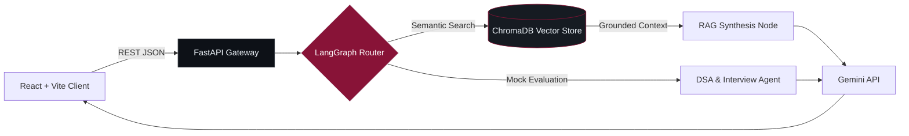

  <!-- Architectural Graphite & Subtle Oxblood Studio Header -->
  

   

  <!-- Editorial Thesis & Typographic Telemetry -->
  

    <b>B.Tech CSAM @ IIIT Delhi</b> &nbsp;·&nbsp; <b>New Delhi, India</b> &nbsp;·&nbsp; <code><b>Open to SWE & AI Roles</b></code> 
    <i>"Mastery is not speed. It is the elimination of wasted motion."</i>
  

  <!-- Unified 4-Channel Command Bar -->
  

    &nbsp;&nbsp;
    &nbsp;&nbsp;
    &nbsp;&nbsp;
    
  

---

### `01 // ENGINEERING DISCIPLINES`

<table>
  <tr>
    <td width="33%" valign="top">
      
<code>I // ARCHITECTURE</code>

      <h4>Full-Stack Systems</h4>
      
Modular backends, role-gated security (RBAC), connection pooling, and clean API contracts engineered for production reliability.

    </td>
    <td width="33%" valign="top">
      
<code>II // INTELLIGENCE</code>

      <h4>Agentic AI & RAG</h4>
      
Stateful multi-agent orchestration, ChromaDB vector retrieval, and context-grounded LLM workflows with low-latency gateways.

    </td>
    <td width="33%" valign="top">
      
<code>III // INTERACTION</code>

      <h4>Spatial XR & Craft</h4>
      
Immersive 3D mathematical environments, physics-driven haptic simulation, and high-precision interfaces with zero clutter.

    </td>
  </tr>
</table>

---

### `02 // SELECTED WORKS`

<table>
  <tr>
    <td colspan="2" valign="top">
      

        <code>01 // FEATURED ARCHITECTURE</code> &nbsp;·&nbsp; <code>AGENTIC AI & RAG</code> &nbsp;·&nbsp; <b>ACTIVE BUILD</b>
      

      <h4><a href="/harsh24239/ai-placement-copilot">AI Placement Copilot</a></h4>
      
Stateful multi-agent interview and placement preparation platform unifying coding practice workflows, grounded vector retrieval, and real-time technical evaluation.

      

        <code>React + Vite</code> &nbsp;➔&nbsp; <code>FastAPI Gateway</code> &nbsp;➔&nbsp; <code>LangGraph Supervisor</code> &nbsp;➔&nbsp; <code>ChromaDB RAG</code> &nbsp;➔&nbsp; <code>Gemini API</code>
      

      

        <a href="/harsh24239/ai-placement-copilot"><kbd> VIEW REPOSITORY ↗ </kbd></a>
      

    </td>
  </tr>
  <tr>
    <td width="50%" valign="top">
      
<code>02 // XR HAPTIC SIMULATION</code>

      <h4><a href="/harsh24239/vr-manual-milling-simulator">VR Manual Milling Simulator</a></h4>
      
Physics-driven virtual machining trainer mapping simulated cutting forces directly to real-time controller haptics.

      
<code>Unity 3D</code> · <code>C#</code> · <code>XR Interaction Toolkit</code> · <code>Blender</code>

      
<a href="/harsh24239/vr-manual-milling-simulator"><kbd> VIEW REPOSITORY ↗ </kbd></a>

    </td>
    <td width="50%" valign="top">
      
<code>03 // SPATIAL COMPUTING</code>

      <h4><a href="/harsh24239/SpatialMath">SpatialMath XR</a></h4>
      
Interactive 3D computation environment translating abstract multivariable mathematics into manipulable spatial scenes.

      
<code>Unity 3D</code> · <code>C#</code> · <code>3D Visualization</code> · <code>Custom Shaders</code>

      
<a href="/harsh24239/SpatialMath"><kbd> VIEW REPOSITORY ↗ </kbd></a>

    </td>
  </tr>
  <tr>
    <td width="50%" valign="top">
      
<code>04 // ACCESS CONTROL & SECURITY</code>

      <h4><a href="/harsh24239?tab=repositories">SQVS — Qualification Verifier</a></h4>
      
Role-gated credential verification system built around strict RBAC permissions, normalized schemas, and immutable audit logs.

      
<code>React</code> · <code>Node.js</code> · <code>Express</code> · <code>MySQL</code> · <code>RBAC</code>

      
<a href="/harsh24239?tab=repositories"><kbd> VIEW ON GITHUB ↗ </kbd></a>

    </td>
    <td width="50%" valign="top">
      
<code>05 // ENTERPRISE DESKTOP CORE</code>

      <h4><a href="/harsh24239?tab=repositories">4-Layer University ERP</a></h4>
      
Decoupled desktop ERP isolating Swing presentation, BCrypt/RBAC service logic, JDBC DAO persistence, and HikariCP pooling.

      
<code>Java Swing</code> · <code>JDBC</code> · <code>HikariCP</code> · <code>BCrypt</code> · <code>JUnit 5</code>

      
<a href="/harsh24239?tab=repositories"><kbd> VIEW ON GITHUB ↗ </kbd></a>

    </td>
  </tr>
</table>

<b><code>+ EXPAND SYSTEM ARCHITECTURE BLUEPRINTS (MERMAID.JS)</code></b>

 

---

### `03 // TECHNICAL SPECIFICATION`

| Layer | Production Technologies & Methods | Stack |
| :--- | :--- | :---: |
| **Languages** | `Python` · `Java` · `TypeScript` · `JavaScript` · `C / C++` · `C#` · `SQL` |  |
| **Web & Backend** | `React` · `Vite` · `FastAPI` · `Node.js` · `Express` · `REST APIs` · `HikariCP` |  |
| **AI & Data** | `LangGraph` · `Multi-Agent RAG` · `ChromaDB` · `Gemini API` · `MySQL` · `SQLite` |  |
| **Spatial & Craft** | `Unity 3D` · `XR Toolkit` · `Blender` · `Figma` · `JUnit 5` · `RBAC / JWT` · `Git` |  |

---

### `04 // TELEMETRY`

  <table>
    <tr>
      <td width="50%" align="center">
        
      </td>
      <td width="50%" align="center">
        
      </td>
    </tr>
  </table>
  
<b><code>DESIGN WITH INTENT</code></b> &nbsp;•&nbsp; <b><code>PRECISION OVER VOLUME</code></b> &nbsp;•&nbsp; <b><code>HARSH.DEV 影</code></b>

