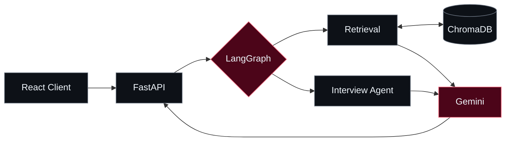

  <!-- Code in the Shadows · Obsidian / Ruby -->
  

  

  

    <b>B.Tech CSE @ IIIT Delhi</b> &nbsp;·&nbsp; Full-Stack &amp; AI Systems Builder
  

  

    
    
    
    
  

---

### `01 // ABOUT`

I build **web applications, agentic AI workflows, and spatial computing experiences**. I care about clear architecture, practical problem-solving, and software that is easy to use and maintain.

Currently exploring **multi-agent systems, retrieval-augmented generation, and full-stack engineering**.

---

### `02 // SELECTED ENGINEERING WORK`

<table>
  <tr>
    <td width="50%" valign="top">
      <h4>AI Placement Copilot &nbsp;<code>IN DEVELOPMENT</code></h4>
      
Placement preparation platform combining multi-agent orchestration, semantic retrieval, and a React-based interface.

      
<code>FastAPI</code> · <code>LangGraph</code> · <code>ChromaDB</code> · <code>React</code>

      
<a href="https://github.com/harsh24239/ai-placement-copilot"><b>VIEW REPOSITORY ↗</b></a>

    </td>
    <td width="50%" valign="top">
      <h4>VR Milling &amp; SpatialMath XR &nbsp;<code>XR / RESEARCH</code></h4>
      
VR milling simulation with haptic interaction, alongside immersive 3D visualizations of undergraduate mathematics.

      
<code>Unity</code> · <code>C#</code> · <code>Blender</code> · <code>XR</code>

      
<a href="https://github.com/harsh24239/vr-manual-milling-simulator"><b>VR MILLING REPOSITORY ↗</b></a>

    </td>
  </tr>
  <tr>
    <td width="50%" valign="top">
      <h4>SQVS — Credential Verifier &nbsp;<code>FULL-STACK</code></h4>
      
Student qualification verification system with role-based access control, relational data modeling, and audit logging.

      
<code>React</code> · <code>Node.js</code> · <code>Express</code> · <code>MySQL</code>

    </td>
    <td width="50%" valign="top">
      <h4>University ERP &nbsp;<code>JAVA / SYSTEMS</code></h4>
      
Desktop ERP built around a four-layer architecture separating UI, services, data access, and persistence.

      
<code>Java Swing</code> · <code>JDBC</code> · <code>HikariCP</code> · <code>JUnit 5</code>

    </td>
  </tr>
</table>

<b>▸ View system architecture — AI Placement Copilot</b>

---

### `03 // TECH STACK`

  

| Focus | Technologies |
| :--- | :--- |
| **Web & Backend** | React · TypeScript · Node.js · Express · FastAPI |
| **AI & Data** | LangGraph · RAG · ChromaDB · Gemini API · MySQL |
| **Systems & XR** | Java · JDBC · HikariCP · JUnit 5 · Unity · Blender |

---

### `04 // GITHUB ACTIVITY`

  
  

  
<code>PRECISION OVER VOLUME</code> &nbsp;•&nbsp; <code>HARSH.DEV 影</code>

  

